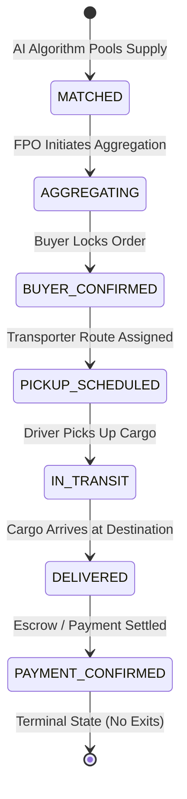

# Order State Machine Engine (Phase 3C)

## 1. Overview & Architecture

The **Order State Machine Engine** (`backend/app/algorithms/order_state_machine.py`) manages the end-to-end lifecycle of aggregated agricultural orders. It enforces strict linear forward progression, validates state transitions, and prevents invalid or out-of-sequence order updates across buyers, FPOs, transporters, and farmers.

---

## 2. Order Lifecycle States

The state machine defines **7 canonical order statuses**:

| State | Status Name | Responsible Actor | Description |
| :--- | :--- | :--- | :--- |
| 1 | `MATCHED` | Matching Engine / AI | Supply lots have been identified and grouped for a buyer requirement. |
| 2 | `AGGREGATING` | FPO / Platform | Farmers are confirming lots and pooling supply at the local aggregation hub. |
| 3 | `BUYER_CONFIRMED` | Buyer | Buyer reviews the aggregated pool and confirms purchase commitment. |
| 4 | `PICKUP_SCHEDULED` | Transporter / FPO | Logistics transporter is assigned and pickup schedule/waypoint route is locked. |
| 5 | `IN_TRANSIT` | Transporter | Goods are picked up from farm/hub and currently in transit to buyer destination. |
| 6 | `DELIVERED` | Buyer / Transporter | Shipment has physically arrived at destination and passed receiving inspection. |
| 7 | `PAYMENT_CONFIRMED` | Platform / Escrow / Bank | **Terminal State**. Final escrow payout is settled to contributing farmers. |

---

## 3. Valid State Transition Graph



### Transition Map Specification

```python
VALID_TRANSITIONS = {
    OrderStatus.MATCHED: [OrderStatus.AGGREGATING],
    OrderStatus.AGGREGATING: [OrderStatus.BUYER_CONFIRMED],
    OrderStatus.BUYER_CONFIRMED: [OrderStatus.PICKUP_SCHEDULED],
    OrderStatus.PICKUP_SCHEDULED: [OrderStatus.IN_TRANSIT],
    OrderStatus.IN_TRANSIT: [OrderStatus.DELIVERED],
    OrderStatus.DELIVERED: [OrderStatus.PAYMENT_CONFIRMED],
    OrderStatus.PAYMENT_CONFIRMED: [],  # Terminal state
}
```

---

## 4. Invariants & Rules

1. **Strict Forward Progression**: Skipping intermediate states (e.g., jumping from `MATCHED` directly to `BUYER_CONFIRMED` or `DELIVERED`) is strictly prohibited.
2. **No Backward Regression**: An order cannot transition backward (e.g., from `IN_TRANSIT` back to `PICKUP_SCHEDULED`).
3. **Terminal State Immutability**: `PAYMENT_CONFIRMED` is the final terminal state. Any transition attempt out of `PAYMENT_CONFIRMED` raises an immediate `InvalidStateTransitionError`.
4. **Case Insensitivity**: Inputs like `"buyer_confirmed"` or `"BUYER_CONFIRMED"` are normalized to the canonical `OrderStatus` enum.

---

## 5. Exceptions & Error Handling

The engine defines dedicated exceptions:

- **`InvalidStateTransitionError`**: Raised when attempting an illegal transition between valid states.
  - *Example message*: `"Cannot transition from 'MATCHED' to 'IN_TRANSIT'. Allowed next states: ['AGGREGATING']"`
- **`InvalidOrderStateError`**: Raised when an unknown or unparseable state string is provided.
  - *Example message*: `"Invalid order status: 'PENDING_APPROVAL'. Valid statuses: ['MATCHED', 'AGGREGATING', ...]`"

---

## 6. API Interface

### Endpoint: `POST /api/aggregation/validate-transition`

**Request Body**:
```json
{
  "current_status": "AGGREGATING",
  "target_status": "BUYER_CONFIRMED"
}
```

**Success Response (200 OK)**:
```json
{
  "valid": true,
  "current_status": "AGGREGATING",
  "target_status": "BUYER_CONFIRMED",
  "allowed_next_states": ["BUYER_CONFIRMED"],
  "error": null
}
```

**Invalid Transition Response (200 OK)**:
```json
{
  "valid": false,
  "current_status": "MATCHED",
  "target_status": "DELIVERED",
  "allowed_next_states": ["AGGREGATING"],
  "error": "Cannot transition from 'MATCHED' to 'DELIVERED'. Allowed next states: ['AGGREGATING']"
}
```
